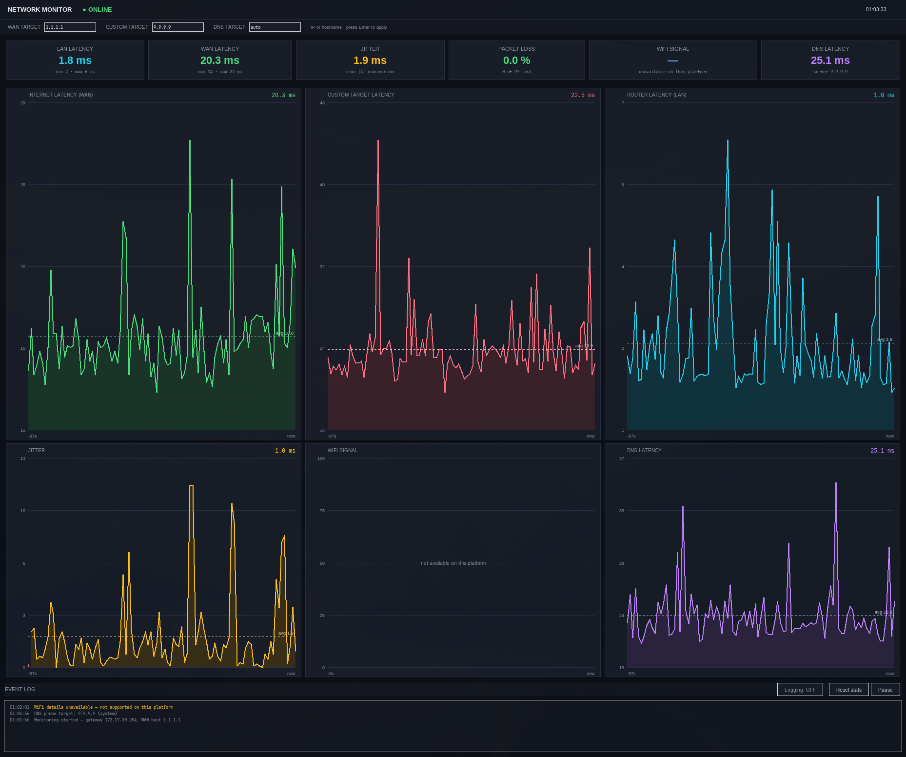

# WiFi / Network Monitor

A live network dashboard in a single Python file. No dependencies — just the
standard library (tkinter, ctypes, raw sockets). Windows-first, but the
headless mode and most probes also work on Linux.



The point of the LAN/WAN split is telling you *where* a problem is:

| LAN | WAN | Status |
|-----|-----|--------|
| ok | ok | `● ONLINE` |
| ok | bad | `● NO INTERNET` — router fine, ISP/VPN issue |
| bad | — | `● OFFLINE` — router/cable/wifi problem |
| bad | ok | `● NO ROUTER` — e.g. VPN split routing |

## Panels

- **LAN latency** — ICMP to your default gateway (router health)
- **WAN latency** — ICMP to an internet host, default 1.1.1.1
- **Custom target** — a third probe to anything you want: another router, a
  VPN endpoint, an internal hop. Set it in the top bar (Enter to apply) or
  with `--extra`. Hostnames are fine and get re-resolved periodically, so
  DDNS/DHCP changes are picked up.
- **Jitter** — mean |Δ| between consecutive WAN samples
- **Packet loss** — failed WAN probes, per session
- **Percentiles** — p50 / p95 / p99 for LAN and WAN latency (under the
  latency cards)
- **Connection score** — ISP-style 0–100 quality score blending latency
  (40%), jitter (30%) and packet loss (30%), with a letter grade. Also
  written to the CSV logs as a `score` column.
- **MTU probe** — a do-not-fragment ping sweep that binary-searches the
  path MTU and checks whether PMTUD works (router sends "fragmentation
  needed") or oversized packets are silently blackholed. Button in the
  bottom bar, or `--mtu [host]` on the CLI.
- **DNS latency** — a real A-record query over raw UDP to your system DNS
  (or a server of your choice — set it in the top bar or with `--dns-server`)
- **Load testing** — fill any path on demand: a built-in mini-iperf
  (`--serve` peer + TCP streams) and a rate-capped rude UDP mode for
  peer-less tests. Latency-under-load (bufferbloat) is measured and shaded
  on the graphs automatically. See **[LOAD_TEST_GUIDE.md](LOAD_TEST_GUIDE.md)**.
- **WiFi signal** — SSID, %, band, link rate. Windows 11 wants the app
  elevated (or Location permission) for this; `run_admin.bat` handles that.
  On Linux this panel is empty.

Graphs have hover tooltips, red tick-marks where packets were lost, a dashed
average line, and auto y-scaling. The event log records up/down transitions,
gateway changes, and weak-signal warnings.

## Running

```
python network_monitor.py
```

Flags:

```
--interval 2          probe every N seconds (default 1)
--window 600          history length in samples (default 300)
--wan 9.9.9.9         WAN probe host (IP or hostname)
--extra 10.0.0.2      custom probe target (IP or hostname)
--dns-server auto     DNS probe server ('auto' = system DNS, the default)
--mtu [host]          path-MTU / PMTUD probe (default: the gateway), then exit
--no-gui              headless mode, prints 5 s of stats and exits
```

## Logging

Toggle **Logging** in the bottom bar. One CSV row per probe interval, written
next to the script — one file per day (`logs/netlog_YYYYMMDD.csv`, appended
to across restarts, rolled over at midnight), or `~/NetworkMonitorLogs` if
that directory can't be created:

```csv
time_iso,epoch,gateway,lan_ms,wan_ms,dns_ms,dns_server,signal_pct,extra_ms,extra_target,load,score
2026-10-16 23:06:01,1792206361.986,10.0.0.1,,60.0,28.6,192.168.0.249,,12.4,,1,87.2
```

Blank cells are real failures — DNS is probed every tick, so a blank there
means the query genuinely failed. WiFi signal is sampled every 10th tick and
forward-filled.

To crunch the logs afterwards:

```
python analyze_log.py                     # auto-finds recent logs
python analyze_log.py logs/netlog_*.csv   # specific files
python analyze_log.py --plot report.png   # + charts (needs matplotlib)
```

Prints min/avg/p50/p95/max, loss %, uptime %, jitter and average connection
score per series.

Or open `LogViewer.html` in a browser: drag one or more `netlog_*.csv` files onto
it (or click to browse) and it renders the full dashboard — charts, stat
cards, zoomable range strip, table view, derived event log — entirely
client-side; the file never leaves the machine. Multiple files become a
session list you can switch between. Sessions that span midnight show
absolute dates ("Thu 24 Oct 14:03") instead of wrapping clock times.

## How it works

- ICMP goes through `IcmpSendEcho` from iphlpapi.dll via ctypes. No ping.exe
  parsing, no locale issues, no admin rights needed. On Linux it shells out to
  `ping -c 1`.
- If ICMP to the WAN target fails while the LAN is fine, it tries a TCP
  connect to port 443 (rate-limited to once a minute) and warns if that
  works — some networks block or deprioritize ICMP while HTTP is fine.
- The DNS probe builds the query packet by hand and validates the reply
  (transaction ID, QR bit, RCODE). A SERVFAIL or spoofed packet doesn't count
  as success.
- Gateway detection parses `route print -4 0.0.0.0` and takes the lowest
  metric; only IP literals count, so "On-link" VPN entries and non-English
  Windows are handled. On Linux it parses `ip route show default`.
- System DNS servers come from `GetNetworkParams` (Windows) or `resolvectl`
  (Linux).
- WiFi details use the native WLAN API with a struct layout verified against
  netsh on Windows 11, with a netsh text parser as fallback. If both fail
  (blocked by privacy settings) the rest of the app works fine.
- The collector runs on a background thread; the GUI refreshes at 1 Hz and
  only redraws what changed.
